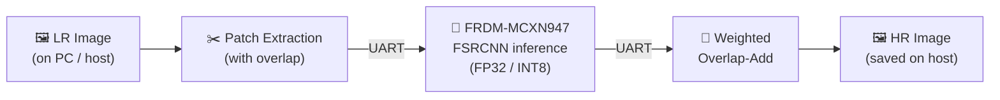

<div align="center">

# 🔬 Patch-Based Super-Resolution on Microcontrollers

### Lightweight FSRCNN running on the **NXP FRDM-MCXN947** with only **512 KB of RAM**

[](#-citation)
[](#-hardware)
[](#)
[](#)
[](https://www.kaggle.com/code/amiraliabedi97/fsrcnn-nxp)
[](#)

<br/>

**Send less. Reconstruct locally. Fit in 512 KB.**

*Image super-resolution ×2 / ×3 / ×4 on a microcontroller, using patch-by-patch inference, overlap-add blending, and INT8 quantization.*

[📄 Paper](#-citation) · [📊 Results](#-results) · [🧩 Pipeline](#-how-it-works) · [🚀 Getting Started](#-getting-started) · [📚 Citation](#-citation)

</div>

---

## ✨ Highlights

| | |
|---|---|
| 🧠 **Tiny model, real hardware** | FSRCNN deployed end-to-end on an MCU with 512 KB RAM and 2048 KB Flash |
| 🧱 **Patch-based inference** | Full frames never fit in SRAM, so we process the image patch by patch and stitch it back |
| 🪄 **4 blending strategies** | Simple average, Linear, Cosine and Gaussian weighting for seamless overlap-add |
| ⚡ **FP32 vs INT8** | INT8 fits patches with **2× the side length (4× the area)** in the same memory budget |
| 📉 **Up to 94% bandwidth saving** | Transmit the LR stream, reconstruct HR locally on the board |
| 🏆 **Beats classical interpolation** | About **+1.2 dB PSNR** over Lanczos at ×3 on DIV2K |

---

## 🎯 Motivation

High-resolution imagery is expensive to **transmit and store**. Super-resolution lets a system send a small low-resolution (LR) image and rebuild the details at the destination.
The catch: CNN-based SR is memory-hungry, and passing a full frame through the network on a microcontroller causes **memory overflow**.

This project solves that by running FSRCNN **patch-by-patch** on the **NXP FRDM-MCXN947**, then merging the outputs with a weighted **overlap-add** scheme that removes blocking artifacts.

---

## 🧩 How It Works



1. **Patch Extraction & Transmission**: the host splits the LR image into small patches and sends them sequentially over UART, so each one fits in on-chip RAM.
2. **On-Board Inference**: the C++ firmware runs FSRCNN on each patch independently.
3. **Weighted Overlap-Add**: overlapping predictions are fused with a normalized weighted sum to remove border artifacts.
4. **Output Storage**: the final HR image is assembled on the host and saved.

> Super-resolution is applied to the **luminance (Y) channel** only. Cb and Cr are upscaled with bicubic interpolation, following standard SISR practice.

### Overlap-add formulation

When the stride `s` is smaller than the patch size `p`, adjacent patches overlap by `o = p − s` pixels. Each overlapping pixel is predicted `K` times and fused as:

```
ŷ(x) = Σₖ wₖ(x) · ŷₖ(x)  /  Σₖ wₖ(x)
```

Pixels near a patch border see less spatial context (zero padding), so they are less reliable. The blending strategies differ only in how `wₖ` accounts for that.

---

## 🎨 Blending Strategies

| Strategy | Weight | Idea |
|---|---|---|
| **Average** | `w = 1` | No extra computation. Border pixels count the same as central ones |
| **Linear** | linear ramp over the overlap | Cross-fades neighboring patches |
| **Cosine** | raised-cosine ramp | Like linear, but with zero slope at both ends for a smoother transition |
| **Gaussian** | `exp(−((i−c)²+(j−c)²) / 2σ²)`, `σ = 0.5` | Weight decays smoothly from patch center to border |

### FP32, ×2, 32×32 patches, 5-pixel overlap

| Method | PSNR (dB) | Gap to full-image closed |
|---|:---:|:---:|
| No overlap | 34.260 | n/a |
| Average | 34.432 | ~73% |
| Gaussian | 34.466 | ~88% |
| Linear | 34.482 | ~95% |
| **Cosine** | **34.484** | **~95%** |
| *Full-image (upper bound)* | *34.495* | *100%* |

💡 **Takeaway:** a small overlap of just a few pixels is enough to approach full-image quality, and Linear and Cosine blending win once the overlap is large enough.

🔎 **Interesting finding:** in INT8, patch-based inference with enough overlap *matches* full-image inference (e.g. 29.321 dB vs 29.313 dB at ×4). We attribute this to static activation-range calibration, which suits the more homogeneous statistics of small patches. The margins are tiny, so we read it as **parity, not improvement**.

---

## 📊 Results

### Quality: FSRCNN vs classical interpolation

Mean over **100 images of the DIV2K validation set**.

| Method | PSNR ×2 | PSNR ×3 | PSNR ×4 | SSIM ×3 | LPIPS ×3 ↓ |
|---|:---:|:---:|:---:|:---:|:---:|
| Nearest-Neighbor | 30.653 | 28.088 | 26.722 | 0.7961 | 0.3478 |
| Bilinear | 31.311 | 29.064 | 27.520 | 0.8134 | 0.2981 |
| Bicubic | 32.397 | 29.636 | 28.092 | 0.8291 | 0.3183 |
| Lanczos | 32.858 | 29.911 | 28.324 | 0.8360 | 0.3236 |
| **FSRCNN-INT8** | **34.304** | **31.081** | **29.313** | **0.8628** | **0.2241** |
| **FSRCNN-FP32** | **34.495** | **31.216** | **29.418** | **0.8658** | **0.2252** |

> Full table (Mitchell-Netravali, Hamming, and SSIM / LPIPS at all scales) is in the paper.

### Memory vs speed on the board (×3)

| Precision | LR patch | RAM used | RAM % | Time / 1280×720 image |
|---|:---:|:---:|:---:|:---:|
| FP32 | 20 × 20 | 291.02 KB | 90.9% | 63.53 s |
| **INT8** | **40 × 40** | 296.34 KB | 92.6% | **55.59 s** (~12.5% faster) |

> With almost the same RAM, INT8 processes patches with **twice the side length** (4× the area). The cost is only about **−0.135 dB PSNR** at ×3.

### Bandwidth reduction

Sending `×n` downsampled LR patches cuts the payload by `n²`:

| Scale | Transmitted data |
|:---:|:---:|
| ×2 | **25%** |
| ×3 | **11.1%** |
| ×4 | **6.25%** |

---

## 🔧 Hardware

| Spec | Value |
|---|---|
| **Board** | NXP FRDM-MCXN947 |
| **Flash** | 2048 KB |
| **RAM** | 512 KB (320 KB for compute and runtime buffers) |
| **Host link** | UART (limited baud rate, so transfer time is a significant part of total latency) |
| **Firmware** | C++ |

---

## 🧪 Training Setup

- **Dataset:** DIV2K
- **Training patches:** 96 × 96 with stride 48
- **Model:** FSRCNN, which works in LR feature space and upsamples with a final deconvolution layer
- **Scales:** ×2, ×3, ×4
- **Precisions:** FP32 and post-training quantized INT8

---

## 🚀 Getting Started

> ⚠️ Adapt the paths and commands below to your actual repository layout.

```bash
# 1. Clone the repository
git clone https://github.com/Amir-Abedi/ISETC2026-FSRCNN_NXP.git
cd ISETC2026-FSRCNN_NXP
```

**Training / evaluation notebooks (Kaggle):**

| Notebook | Link |
|---|---|
| FSRCNN on NXP | [kaggle.com/code/amiraliabedi97/fsrcnn-nxp](https://www.kaggle.com/code/amiraliabedi97/fsrcnn-nxp) |
| Classical interpolation baselines | [kaggle.com/code/amiraliabedi97/classical-interpolation](https://www.kaggle.com/code/amiraliabedi97/classical-interpolation) |

**Typical workflow:**

1. Train FSRCNN (FP32), then quantize to INT8
2. Flash the C++ firmware to the FRDM-MCXN947
3. Run the host script: it splits the LR image into patches, sends them over UART, receives the upscaled patches, and applies overlap-add
4. Compare the output against the classical interpolation baselines

---

## 🗂️ Repository Structure

```text
.
├── firmware/        # C++ code for the FRDM-MCXN947
├── host/            # Host scripts: patching, UART, overlap-add
├── training/        # FSRCNN training & quantization
├── results/         # Tables, plots, example outputs
├── docs/            # Paper and figures
└── README.md
```

> 📝 Edit this tree to match your real folders.

---

## 👥 Authors

| | |
|---|---|
| **Amirali Abedi** | Communications Department, Politehnica University Timișoara · ✉️ amirali.abedi@student.upt.ro |
| **Muguras Mocofan** | Communications Department, Politehnica University Timișoara · ✉️ muguras.mocofan@upt.ro |

---

## 📚 Citation

If you find this work useful, please cite:

```bibtex
@inproceedings{abedi2026patchsr,
  title     = {Patch-Based Super-Resolution Using Lightweight Convolutional Neural Networks on Resource-Constrained Microcontrollers},
  author    = {Abedi, Amirali and Mocofan, Muguras},
  booktitle = {ISETC 2026},
  year      = {2026},
  publisher = {IEEE}
}
```

---

## 🙏 Acknowledgment

This work was supported by the European Union – NextGenerationEU, through the National Recovery and Resilience Plan (PNRR) of Romania, Component 9, Investment 4, under the Important Project of Common European Interest (IPCEI ME/CT), project *Perception, Intelligent Processing and Communications – innovation in the value chain with Politehnica University Timișoara* (Contract No. 8.PI/I4/C9).

The content of this material does not necessarily represent the official position of the European Union or the Government of Romania.

---

<div align="center">

⭐ **If this project helped you, consider giving it a star!** ⭐

Made at **Politehnica University Timișoara** 🇷🇴

</div>
